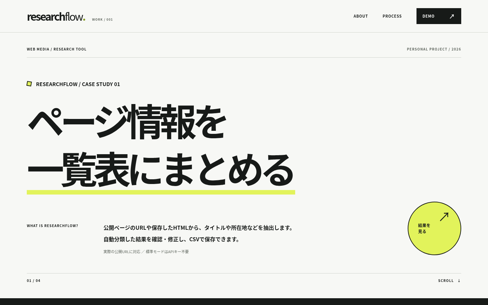

# ResearchFlow v0.7 — Webメディア向け情報収集ツール

**公開アプリ：** https://researchflow-portfolio-msr4p7iwappfodx5am4eshb.streamlit.app/

**公開環境で確認済み：** 画面の表示、架空HTML 6件の抽出・分類、編集結果のCSVダウンロード（GitHub Actionsのブラウザ検証）。公開URLからの実ページ取得はサイト側のアクセス制限等を含め、別途検証が必要です。


公開URL、HTMLファイル、または同梱サンプルを入力し、ページからタイトル・概要・所在地・開催日を抽出し、カテゴリを推定して編集可能な一覧表とCSVを作成するポートフォリオ用ツールです。

外観はv0.5のデザインを維持し、v0.6で実装した公開URL取得・編集・CSV保存に対応しています。v0.7は初回操作を簡単にし、GitHubとStreamlit Community Cloudへの公開準備を進めた版です。



**位置づけ：** 個人ポートフォリオの技術デモです。受託案件での納品実績や、実際の業務削減効果を示すものではありません。生成AIを開発補助に利用しています。

## 機能

1. **公開URLの入力：** 1行に1URL、最大8件。実行ボタンを押したときのみアクセス。リダイレクト・robots.txtの確認に対応。
2. **HTMLアップロード：** UTF-8形式のHTMLを最大8件読み込み（各1MB以下）。取得が制限されたサイトでも、適切な権限で保存したHTMLから解析可能。
3. **情報抽出：** BeautifulSoupで`title`、メタディスクリプション、見出し、本文、JSON-LDに含まれる住所・開催日を抽出。
4. **無料分類：** scikit-learnの日本語文字n-gram＋ロジスティック回帰で4カテゴリへ推定。小規模な例文（56件）で学習するため、**実運用精度は未検証**。
5. **確認・修正：** Streamlitの表でカテゴリ・概要・所在地・開催日・確認状況・メモを編集。`対象外`の行はCSVから除外。
6. **根拠の確認：** URL・抽出された原文の抜粋・モデルスコアを表示。元ページと照合することを前提とする。
7. **CSV出力：** UTF-8 BOM付き。表計算アプリでの数式注入対策を実装。
8. **Gemini API（任意）：** 利用者が設定するサーバー側APIキーによる分類・概要生成。公開デモでは未設定を推奨。無料利用の条件や上限は提供元で確認が必要。

### 無料AIについて

標準モードは無料でインストールできるscikit-learnの**機械学習による分類**であり、生成AIではありません。要約は原文からの抽出で、自由な文章生成はしません。Geminiを使う場合にのみ生成AIが外部に本文を送信します。社外秘・個人情報は送信しないでください。

## 起動方法

Python 3.11〜3.13を推奨。初回インストールにはネットワーク接続が必要です。

```bash
python -m venv .venv
# Windows (cmd)
.venv\Scripts\activate.bat
# macOS / Linux
source .venv/bin/activate
pip install -r requirements.txt
streamlit run app.py
```

ブラウザで `http://localhost:8501` を開き、`公開URLを取得` → `URLを1行ずつ入力` → `情報収集を実行` の順に操作します。URL取得がブロックされた場合はHTMLアップロードに切り替えます。体験用に架空HTMLも同梱しています。

Gemini機能はデフォルトで無効です。必要な場合は、サーバーの環境変数 `GEMINI_API_KEY` および `ENABLE_REMOTE_AI=1` を設定します。APIキーをソースコードや公開リポジトリへ書き込まないでください。

## ブラウザプレビュー

`preview.html` はダウンロードしてブラウザで開けるHTML版です。このHTML版も **新しいHTMLファイルを読み込んで解析**できます（ブラウザ内の`DOMParser`＋**簡易キーワード分類**）。カテゴリ・確認状況の編集、検索、CSV保存にも対応します。HTMLはサーバーに送信されません。

**重要：** ブラウザ版ではWebページURLへの直接アクセスはできません。通常のブラウザのクロスオリジン制約があるため、公開URLの取得・ローカル機械学習分類・自由記述欄の編集はStreamlit版で行います。両者で分類アルゴリズムが異なります。ブラウザ版の結果は機能説明用であり、Streamlitの完全な代替ではありません。

## 公開URL取得の安全対策

- HTTP(S)の標準ポートのみ。内部IP、IP直指定、localhost、`.local`等へのアクセスを拒否。
- DNSの全結果を検証し、接続先IPを固定してTLS検証を実施。リダイレクト先も再検査。
- ページ取得前に`robots.txt`を確認し、禁止・不明・crawl-delay指定サイトは取得を中止。
- 8件上限、ページの最大サイズ450KB、タイムアウト、リダイレクト数の制限。
- JavaScriptの実行、ログイン、CAPTCHA回避、サイト内のリンク巡回、定期実行は行いません。

これは汎用クローラーではありません。公開環境での第三者利用に際しては、利用数・ホスティング費用や追加のネットワーク制約が必要か確認してください。サイトの利用条件と著作権を尊重して使用してください。

## 検証

```bash
python -m pytest -q
python scripts/build_preview.py
python scripts/visual_qa.py
python scripts/interactive_qa.py
```

テストには、URLの入力検証・DNSの内部IP拒否・リダイレクトの安全性・robots.txt・模擬URL取得から分類・確認修正・CSV出力・ブラウザのファイル読み込みと編集操作を含みます。

**未検証：** 作業環境にStreamlitパッケージがなく、外部DNSアクセスが制限されているため、Streamlit本体の起動と実際のインターネットサイトへのGETは、この環境では確認できませんでした。単体・統合モックテストとブラウザ版の実操作を検証しています。公開前にStreamlit Cloud上で、アクセス許可されている公開URLを使って最終検証が必要です。

## 公開までのステップ

専用の手順書 [DEPLOY.md](DEPLOY.md) にGitHubリポジトリ作成、Streamlit Community Cloudでの初回デプロイ、公開後の動作確認を記載しています。GitHubのソースコードと公開手順を確認できます。Streamlit Community Cloudでのデプロイおよび実サイトでの動作確認は別途必要です。
